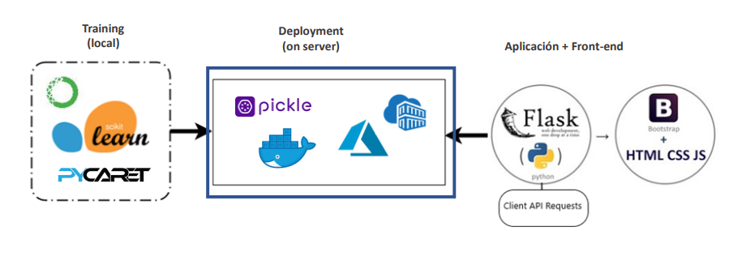
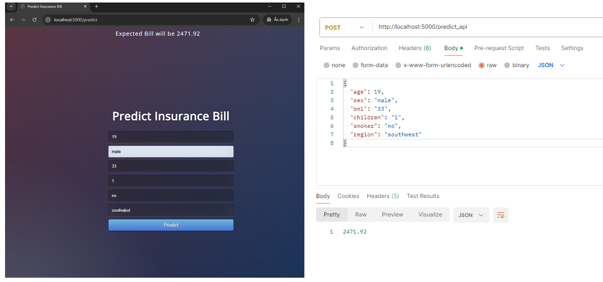

# MLOps-course
MLOps Specialize: Udemy Bootcamp 2022 

## Section 17: Docker and containers in Machine Learning

**1. Create Docker Image file:**

⚙️ Pycaret support generate docker image from pipeline
```python
from pycaret.regression import create_model, create_api, create_docker
# create model
lightgbm = create_model('lightgbm')
# create API
create_api(lightgbm, 'my_first_api')
# create Docker
create_docker('my_first_api')
```

Open and run [this notebook](Create_container_for_an_API.ipynb) to create model,apis and dockerfile

> 🔍 [Building docker images](https://docs.docker.com/get-started/docker-concepts/building-images/)

**2. Build Docker Image from Dockerfile:**

Open PowerShell as Admin, run this command:
```bash
docker image build -f "Dockerfile" -t my_image:api_diamond .
```


**3. Build Container from Image:**

List all running docker images and create container:
```bash
docker run -d -p 8080:8000/tcp --name my_container my_first_image:api_diamond
```


After successfully building the container


**3. Use API via container:**


### Build  Insurance Bill app
> use same app from [Session 16](https://github.com/Brycenvn/MLOps-course/tree/Section-16--Flask-for-application-development)

1. Prepare the environment 
    ```bash
    cd insurance_bill
    ```
2. Create the `requirementx.txt` and the `Dockerfile`
3. Build the Docker image with 
    ```bash
    docker build -t pycaret.azurecr.io/pycaret-insurance:latest .
    ```
4. Test running 
    ```bash
    docker run -d -p 5000:5000/tcp pycaret.azurecr.io/pycaret-insurance
    ```
