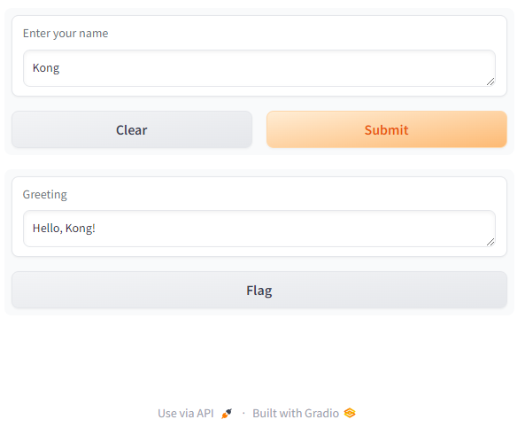

# MLOps-course
MLOps Specialize: Udemy Bootcamp 2022 


## Section 15: MLOps Phase 3: Model serving with Web Applications
Several Low-code GUI application framework for quickstart:
| Python GUI Package | Type     |
|--------------------|----------|
| [Streamlit](https://docs.streamlit.io/get-started) | `web_app` |
| [Gradio](https://www.gradio.app/guides/quickstart)             | `web_app` |
| [Taipy](https://docs.taipy.io/en/latest/tutorials/getting_started/) | `web_app` |
| [NiceGui](https://nicegui.io/)             | `front_end` |
| [PyQT](https://www.pythonguis.com/pyqt6-tutorial/)                | `app`     |
| [Tkinter](https://www.pythonguis.com/tutorials/create-gui-tkinter/)             | `app`     |


In this Section we focus on serving model via Web Apps using these common framework:
- **Gradio**
- **Streamlit**

### 1. Run first simple Gradio app
Install Gradio package
```bash
pip install gradio
```

Create simple app
```python
# Simple Gradio App
import gradio as gr

def my_func(name):
    return f"Hello, {name}!"

app = gr.Interface(fn=my_func, 
                     inputs=gr.Textbox(label="Enter your name"), 
                     outputs=gr.Text(label="Greeting"))

app.launch()
```



**Interface**: The main object that connects inputs, outputs, and the processing function.

1. **Inputs**: [list] Types of data users provide. Common components include:
    - `gr.Textbox`: Text input.
    - `gr.Radio`: Single-choice selection.
    - `gr.Slider`: Numeric value selection.
    - `gr.Image`: Image uploads.

2. **Outputs**: How results are displayed. Common types include:
    - `gr.Text`: Plain text output.
    - `gr.Image`: Display images.
    - `gr.Dataframe`: Show tables.

3. **Function**: The Python function that processes inputs and generates outputs.


**Pycaret** support generate Gradio App
```python
from pycaret.regression import create_model, create_app
model = create_model('lightgbm')
create_app(model)
```