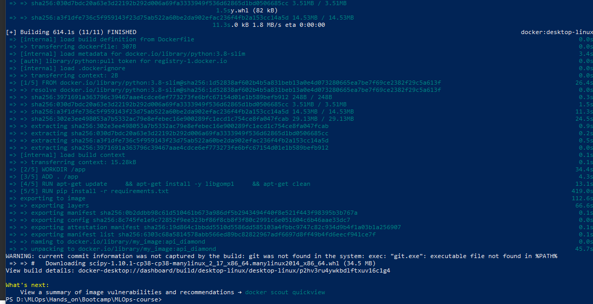
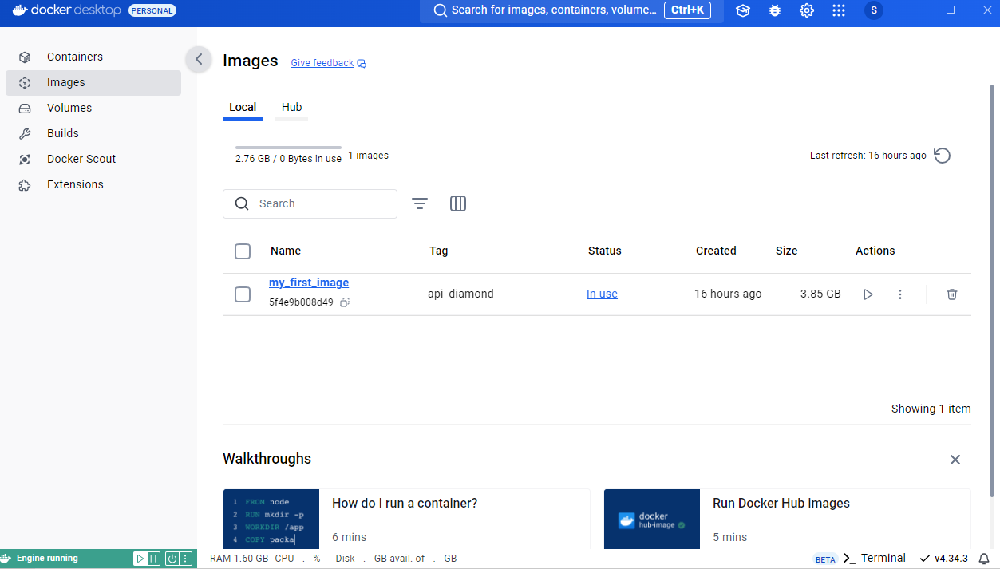
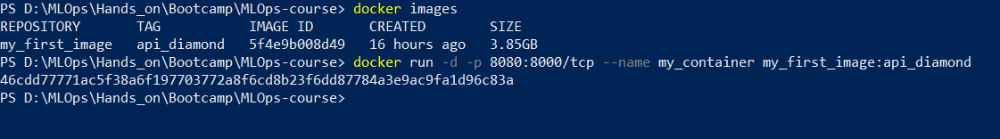
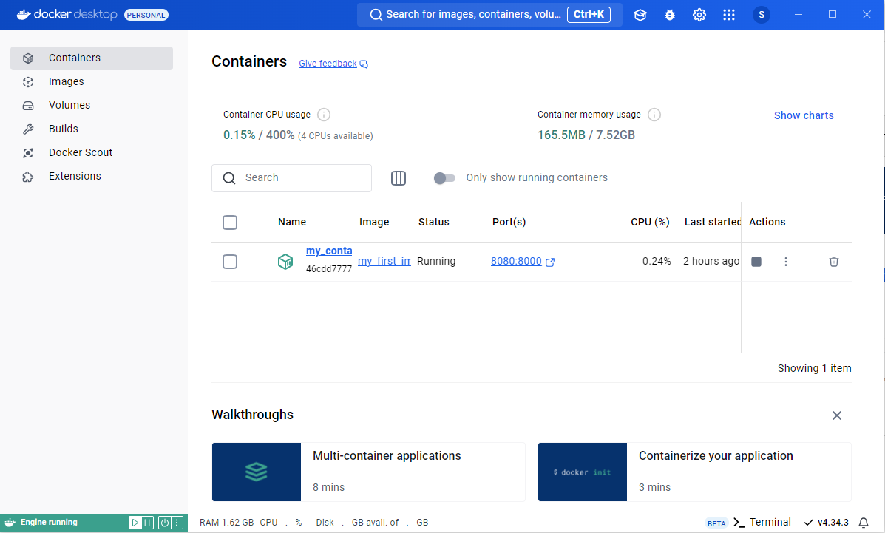
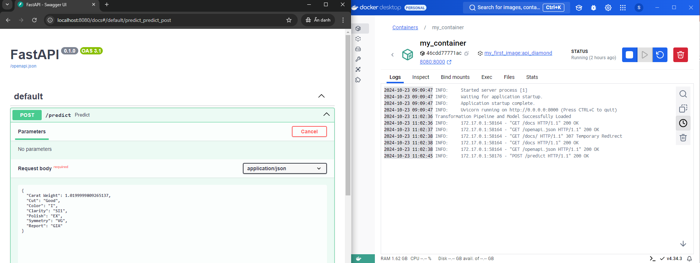

# MLOps-course
MLOps Specialize: Udemy Bootcamp 2022 

## Section 17: Docker and containers in Machine Learning

**1. Create Docker Image file:**

⚙️ Pycaret support generate docker image from pipeline
```python
from pycaret.regression import create_model, create_api, create_docker
# create model
lightgbm = create_model('lightgbm')
# create API
create_api(lightgbm, 'my_first_api')
# create Docker
create_docker('my_first_api')
```

Open and run [this notebook](Create_container_for_an_API.ipynb) to create model,apis and dockerfile

> 🔍 [Building docker images](https://docs.docker.com/get-started/docker-concepts/building-images/)

**2. Build Docker Image from Dockerfile:**

Open PowerShell as Admin, run this command:
```bash
docker image build -f "Dockerfile" -t my_image:api_diamond .
```





**2. Build Container from Image:**

List all running docker images and create container:
```bash
docker run -d -p 8080:8000/tcp --name my_container my_first_image:api_diamond
```


After successfully building the container



**3. Use API via container:**

