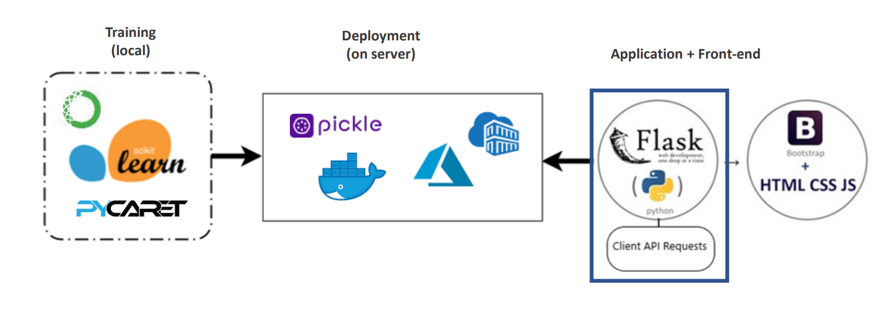
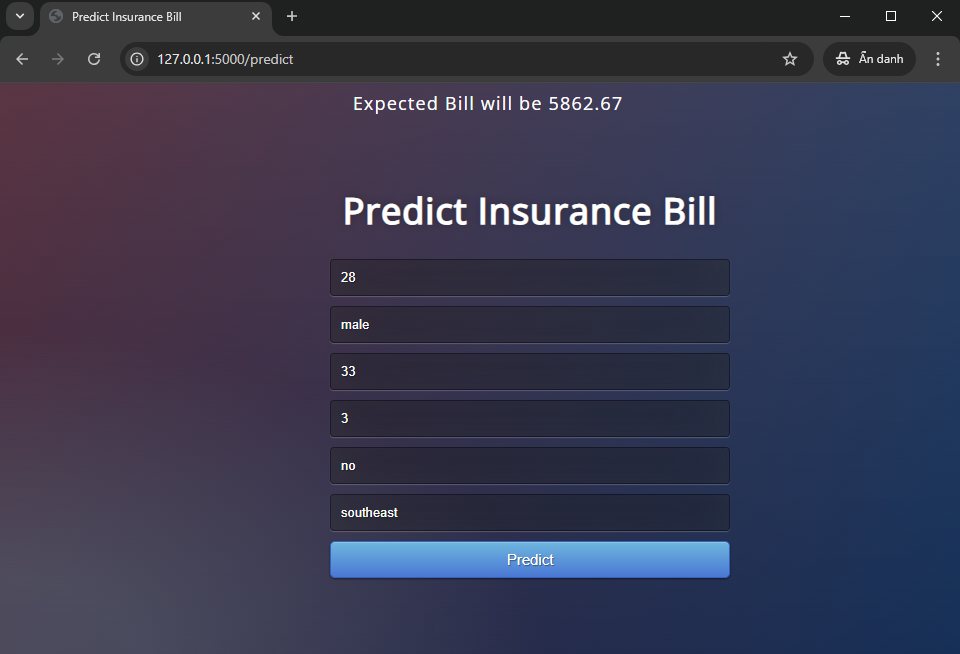

# MLOps-course
MLOps Specialize: Udemy Bootcamp 2022 

## Section 16: Flask for application development

Building a project from start to finish with Flask


Install neccessary packages

```bash
pip install -r requirements.txt
```


**1. Fundamental FlaskAPI app**

```python
from flask import Flask

# Flask constructor takes the name of
# current module (__name__) as argument.
app = Flask(__name__)

# The route() function of the Flask class is a decorator,
# which tells the application which URL should call the associated function.
@app.route('/')
# ‘/’ URL is bound with hello_world() function.
def hello_world():
	return 'Hello World'

if __name__ == '__main__':
# run() method of Flask class runs the application on the local development server.
	app.run()
```

Run Flask app
```bash
python FlaskFundamentals.py
```

**2. Serving Model with Flask app**

> 👍 Run Notebook [Insurance - Model Training Notebook.ipynb](2.%20Streamlit/Insurance%20-%20Model%20Training%20Notebook.ipynb) to get Data and Model

Run Flask app
```bash
python app.py
```
